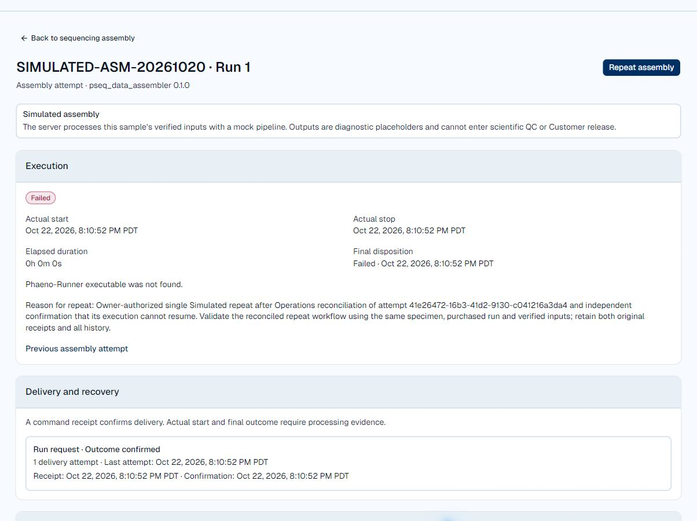

# Assembly reconciliation hosted-test release — October 22, 2026

The reconciliation and quiet-refresh changes are committed, pushed and deployed to hosted test. The original conflict is reconciled with both receipts and all original execution history preserved. Exactly one linked, Portal-classified Simulated repeat ran and ended **Failed** because the current DPS recipe calls a missing Phaeno-Runner executable. Successful simulation/output acceptance remains incomplete; no second repeat or DPS modification was performed.

## Authorized scope and target

The Owner authorized publication and deployment of the Operations reconciliation and quiet-refresh changes to the existing hosted test environment, followed by review of `SIMULATED-ASM-20261020` and exactly one linked Simulated repeat after confirming that its original execution cannot resume. Target: Portal `https://portal.phaenobiotech.com`, API `https://api.phaenobiotech.com`, existing green PostgreSQL 18.6 container and volume on the current Portal host. No database replacement, reset, migration, identity/storage cutover, Website deployment or scientific/customer release is included.

## Preservation and recovery gates

Preserve every current table and record, including complete `website.web_contacts` and `website.web_orders` history, IDs, actor references, timestamps and states; all assembly receipts, original execution facts and journal history; every current runtime/document/Local file and existing S3 object. Create a fresh protected encrypted database/file/runtime recovery package; verify an isolated PostgreSQL 18.6 restore against every table fingerprint, then collect encrypted recovery off-server and verify its envelope. Retain the current API image/release and frontend deployment as rollback targets. Populated-S3 recovery remains deferred under the existing hosted-test exception; do not activate the disabled backup timer or change storage.

## Release and rollback

Publish a scoped `codex/` branch through the protected PR path. Require all three exact-source UI jobs and a production frontend build. Stage the production-environment Portal frontend without domain assignment. Activate the matching API through the protected release script with migrations and identity cutover false, retaining its lock, source-quality, auth, storage and scanner guards. Promote the tested frontend only after API verification. Keep both Vercel Git holds and the quarantined zero-job deployment run unchanged; do not retry that orphan. Use the established bounded direct-host release path if the quarantined Actions condition still prevents safe workflow dispatch. Keep `Deploy Portal Green` disabled outside any authorized bounded run.

On application failure, return to the retained API image and frontend deployment; no data rollback is needed because the schema is unchanged. Never restore the pre-release database over subsequent activity. Any data recovery requires a separately reviewed exact scope. Preserve failed-attempt evidence rather than editing dispositions or receipt rows.

## Acceptance sequence

1. Verify release identity, health, scanner, TLS discovery, unchanged runtime/provider settings, all table/file fingerprints and Website intake contents before the authorized business writes.
2. In the signed-in Portal, verify quiet background refresh across polling boundaries: loaded rows and geometry stay stable, ended attention polls at thirty seconds, and active work uses five seconds.
3. Independently inspect DPS processes, pending commands, execution/resumption behavior and target execution state. Missing ledger history or a NotAccepted response alone cannot satisfy the no-resumption condition. Stop before reconciliation if the evidence is insufficient.
4. Review retained attempt `41e26472-16b3-41d2-9130-c041216a3da4` with the new workflow, retain Failed and all original start/stop/disposition facts, and append the reason and actual independent verification. Compare both original receipts and historical events byte-for-byte afterward.
5. Request exactly one Simulated repeat linked to that latest attempt for work order `46b38b3a-0c54-463e-b048-eb37b9787c75`, specimen `231806cd-8168-4fcb-80fc-80c3bd060dff`, purchased run 1. Verify one Run dispatch, linked lineage, terminal outcome and placeholder output checks. Do not retry automatically if this execution fails or conflicts.

## Evidence

Local verification: [87 backend, 20 frontend, focused browser and strict visual checks](../testing/runs/2026-10-22-assembly-operations-reconciliation.md). Production frontend build and production/gallery isolation pass during release preparation. Executed release identities, fresh recovery hashes, hosted observations and repeat results follow.

## Released identity and checks

| Item | Identity |
| --- | --- |
| Reviewed API/frontend source | `0dc6391c74ebe39fa10bdeae73bf67706f86ba87` |
| Protected merge | [PR #5](https://github.com/behaack/phaeno-ops-mgmt-system/pull/5), `25701813489d681048ba4080d5b8b86456758830` |
| Matching source/merge tree | `28e340a80b9d1e36f9b84dd38fcd1b151c1fd808` |
| Exact Git archive SHA-256 | `1794b59da48cebadc4277fe35733119e963b59e7ef74029a9d6b0f4d302a3ea9` |
| API image | `phaeno-portal-green-api:sha-0dc6391c74eb-manual-20261022-5` |
| API image ID | `sha256:0c2c513d5750159c05255f52d4a1a9bf597f3c6c24f1c08aa81117ca6eb6c977` |
| API release | `/opt/phaeno.portal-green/releases/0dc6391c74ebe39fa10bdeae73bf67706f86ba87-manual-20261022-5` |
| Frontend | `dpl_EZzXjhyhEirkaC1qyw8aGR821FwU`, `phaeno-ops-mgmt-system-knki3k94b-cadexgenomics.vercel.app` |
| Help corpus | 62 guides, `7e53c40e62e0` |

All three required exact-source jobs pass in [the PR run](https://github.com/behaack/phaeno-ops-mgmt-system/actions/runs/39891117217) and [the branch run, attempt 2](https://github.com/behaack/phaeno-ops-mgmt-system/actions/runs/39891112165). The first branch attempt stalled installing browser dependencies before tests; that ordinary CI run was cancelled and retried without changing checks or bypassing protection. [Merged-source CI](https://github.com/behaack/phaeno-ops-mgmt-system/actions/runs/39892899314) also passes all three jobs. Strict Windows visual comparisons and required check names/app/admin enforcement remain unchanged.

The frontend was staged with custom-domain assignment disabled. Its root and 15 entry assets passed protected readback; all 15 canonical assets match the staged bytes after promotion. The existing signed-in tab received `index-mkSSQEo4.js` after advancing the release boundary to `1792724844666`; the twelve-hour skew maximum remains unchanged. The prior auto-assignment setting was restored, and both Git deployment holds remain false.

The protected direct-host script retained its exact-source check, deployment lock, runtime/auth/storage/scanner guards, rollback behavior and Website content verification. Migrations and identity cutover were false. Scanner clean/EICAR/encrypted/oversize checks and both-area file-service verification pass. Only the existing DPS SSH tunnel restarted to follow the new API namespace; actual API discovery reports TLS 18883 available. API/database/scanner are healthy, public API health and Website return 200, and anonymous assembly reads remain 401. OCIA containers and start identities are unchanged.

## Recovery and preservation results

Fresh recovery is retained under `/var/backups/phaeno-portal-deploy/assembly-reconciliation-20261022`. An exported PostgreSQL snapshot coordinates the dump and complete table fingerprints. Isolated PostgreSQL 18.6 restore reproduces all 250 table fingerprints. All 117 runtime/document/Local file hashes and modes are verified, including independent off-server decryption in memory. A comparison-format error in the task-owned verifier was corrected before the successful all-table check; no live restore or database mutation occurred.

| Pre-workflow encrypted artifact | SHA-256 |
| --- | --- |
| `recovery.tar.gz.enc` | `ceb4ada94ff267ab78cef631cfaa5871d01eca2ea2fd8e39acce7024ada0aac9` |
| `recovery.key.enc` | `7e196bc7ed2e39e7f0210f7eb776d71ecda208674fbd936c70a807f2736e6f89` |

An additional complete recovery under `post-workflow/` includes the appended reconciliation decision and failed repeat. Its isolated restore again matches all 250 tables and 117 files; encrypted hashes are `1aabf19c3ee48312884ed1b9efd681d17fd77691d128cc4057b7563294cda6fc` (package) and `a1d627f2ca8f733dfa9be2443a388a71771e3b930ef77bdb532d7164b13995c5` (wrapped key). Encrypted copies are collected off-server and independently verified without writing decrypted recovery to disk.

Before business actions, all 250 live table fingerprints were unchanged. All 115 unrelated files remained unchanged; only compose/release metadata changed. All 29 existing migrations remain through `20261017190934_SplitInternalOrderNotes`. Complete Website intake is unchanged: 12 contacts and six Demo requests, fingerprints `826036c308546ee5cd5a40f5d20cf98e` and `aeb227431e53d5a25743b3d0671abc47` under this receipt's sorted JSON/newline fingerprint convention. After the authorized workflow, 243 table fingerprints remain identical; seven changed tables are assembly jobs/commands/receipts/events, scoped work-order/events and centralized audit history. No account, Website intake, scientific-analysis or result-release data changed.

Prior API image `sha256:1303f1c5047dbabb11859c5ffad1c64d013d05b894c1e39858a80f0c4dfe0acb` and frontend `dpl_3HTYkVX5HfKrxvg4JXSNfJKbgzrD` remain rollback targets. Populated-S3 recovery deferral and the disabled backup timer remain applicable. No older database was restored over workflow activity.

## Hosted quiet refresh and reconciliation

The actual signed-in specimen list changed from five-second polling to thirty-second polling while its ended conflict needed attention. Access-log timestamps include `03:07:39Z` and `03:08:09Z`; all four loaded row positions/heights are identical across the refresh and no refreshing row appears. Once settled, polling stops as designed. Five-second active fallback behavior retains focused test/CI evidence; this live repeat ended too quickly to prove sustained active polling.

Independent verification at `2026-10-23T03:09:07Z` found only DPS PID 45969, launched `2026-10-22T23:47:22Z`, after the original execution ended. The original worker processes are gone. The replacement holds the exclusive OS ledger lock, has no active ledger jobs and no entry for the original attempt. Inspected runner code resumes only nonterminal ledger entries and returns for missing/terminal entries. DPS uses clean MQTT sessions and POMS Start messages are nonretained. The original Run was delivered once and confirmed, with no next retry or pending command; Portal had zero active attempts. Missing history/NotAccepted alone was not treated as proof. No DPS restart, ledger edit or manual outcome repair occurred.

Reconciliation event `f87f3ef4-babd-4598-a3ac-b83a90cf94db` was appended at `2026-10-23T03:09:32.854306Z` by the existing signed-in authorized actor `19a51eb3-1a16-43b2-941f-ef3149bc3f93`. Its reviewed fingerprint is `16E32D97A6884A2E040FBE09044CBB98E17C39DCB22D6BF6542FD8B1A8623990`; its fresh read-only provider observation records missing history. The independent verification, reason and no-resumption confirmation are retained in the decision. Attention cleared and the separate Repeat assembly action appeared.

Readback before and after the repeat confirms all eight original lifecycle receipt rows, including both disputed terminal payloads/hashes/outcomes, all six original journal rows and the original Run command are identical. Only one journal decision was appended. Original Failed state, provider identity, start `2026-10-21T22:59:18.123740Z`, stop/disposition `2026-10-21T23:00:10.791873Z` and ledger error reason remain unchanged.

## Single linked repeat and remaining provider issue

Attempt [`b3187a23-d258-4c85-8866-900021cff3d5`](https://portal.phaenobiotech.com/lab-operations/assembly-jobs/b3187a23-d258-4c85-8866-900021cff3d5) links directly to `41e26472-16b3-41d2-9130-c041216a3da4`. It retains the same specimen, purchased run 1, recipe and two input identities/checksums/byte sizes; verification and per-attempt DPS/output-storage handoff metadata are fresh as intended.

- Requested `2026-10-23T03:10:50.520217Z`; one Run delivery, confirmed with no next retry.
- Actual start `2026-10-23T03:10:52.026349Z`; stop/disposition `2026-10-23T03:10:52.146553Z`.
- Final **Failed**: `Phaeno-Runner executable was not found.` No attention conflict, output manifest, linked analysis or released result exists. DPS confirms the terminal event committed.
- No second attempt, provider edit, restart or executable installation was performed.

Read-only diagnosis finds the current DPS `DpsJobRunner` invokes `PSeqRecipe.RunRecipe`; its `CallPhaenoRunner` requires `${PB_RUNNER}/phaeno`. `PB_RUNNER` is `/home/ubuntu/development/pipeline/apps/phaeno/target/release`, and that executable does not exist. This provider behavior differs from the Portal-approved Simulated classification. The next provider work must restore or explicitly map a genuine simulation path before any further Simulated repeat; simply installing a scientific runner would not establish simulation-only behavior. Successful placeholder-output acceptance, real scientific/provider qualification and Customer release remain unproven.

