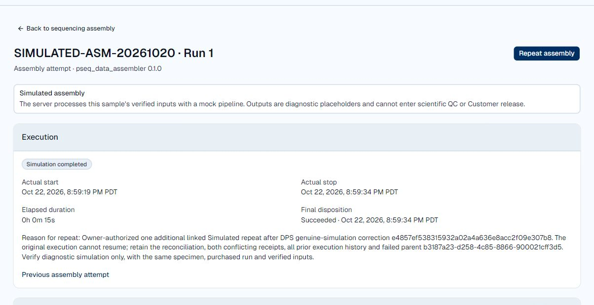

# Genuine DPS simulation — hosted-test release receipt

The Owner authorized a DPS simulation correction, hosted-test deployment and exactly one additional linked repeat for `SIMULATED-ASM-20261020`, preserving all receipts and execution history. Deployment and that repeat succeeded October 22 PDT / October 23 UTC. This supersedes the missing-runner simulation blocker in the [reconciliation receipt](assembly-reconciliation-test-release-20261022.md).

## Published source and deployed behavior

Correction **`e4857ef538315932a02a4a636e8acc2f09e307b8`**, based on upstream `ff84df7a81ebba9f02e0a46dd049c009e2b309e2`, is published in [pipeline PR #2](https://github.com/phaenobiotech/pipeline/pull/2).

The reserved `pseq_data_assembler` 0.1.0 recipe verifies pinned input bytes, runs an in-process cancellable simulation and uploads checksum/version-verified diagnostic outputs. This exact identity never invokes `PSeqRecipe`, reads `PB_RUNNER` or starts Phaeno-Runner. Other identities retain their separate runner path. Duration defaults to 15 seconds, bounded to 0–900. Only verified output/manifest completion publishes 100%; existing durable lifecycle and final acknowledgment behavior remains. FASTA/JSON and provenance explicitly identify simulation and `scientific_use: false`.

During preparation, the maintainer independently stopped PID 45969, removed its old build and moved source from `apps/MQTT_Test` to `apps/pseq_server`. The initial correction `f79e82c` was staged but never activated. After the Owner instructed retrying, the same five-file fix was applied to the current relocated source, preserving the maintainer's unrelated runner-error improvements. Because the former executable had already been removed externally, rollback was reconstructed from retained upstream `ff84df7` in a separate directory. Existing launcher settings, the existing CN=dps client identity, shared storage profile and original ledger were retained without issuing or changing credentials.

Automatic approval review rejected a direct fast-forward push to default `main`, stating that hosted-test deployment authorization did not clearly authorize bypassing the open review PR. No default-branch mutation occurred. PR #2 remains open for review and explicit merge approval; the verified hosted deployment is active independently of that merge.

## Checks and activation

Ten new simulator cases pass on Windows: reserved identity cannot call the scientific runner; other identities are not silently simulated; pre/during-run cancellation cannot fall through; output verification owns 100%; and duration bounds are enforced. The broader 38-case Windows selection had six existing ledger-lock cleanup failures. All **38/38** selected simulation, lifecycle percentage, timestamp, command-builder and command-assertion cases pass in Release on the actual Linux ARM64 host, including those six. Existing unrelated scientific-runner nullability and Unix-mode test annotation warnings remain. No full scientific/provider suite is claimed.

Native framework-dependent .NET 9 Linux ARM64 release:

```text
/home/ubuntu/.phaeno/DPS/releases/e4857ef538315932a02a4a636e8acc2f09e307b8
dps.dll SHA-256 706cbe728ff3db6a01e4d0d08a81950c628b2458bdb2f97600af452cc84c0f7b
source.tar SHA-256 792f9910eb3dfbe81b34f1c1892a02cd713b6563dfbaca2666e954b60d3114e1
source.bundle SHA-256 02a3c3855c8ed31127b397f2511a9e31c39e08d226dc74698b619c6c9c31c493
```

Activation at `2026-10-23T03:58:40Z` verified zero active Portal jobs, zero pending Run deliveries, zero active provider jobs and no competing worker. One replacement, PID **51269**, connected using validated mutual TLS on 18883 and held the existing ledger's exclusive FLOCK. All three prior provider records compared exactly unchanged at startup and after execution. The original conflicted execution is absent from the ledger; recovery resumes only nonterminal jobs, all retained provider jobs were terminal, the former worker is gone and no non-retained Start was replayed. These facts extend the independent no-resumption evidence already recorded during reconciliation.

No Portal runtime source, schema, migration, dependency, authentication, broker, storage selection, Website or OCIA change. Portal API/frontend remain at reconciliation application source `0dc6391c74ebe39fa10bdeae73bf67706f86ba87`. The existing API workflow hold, orphan quarantine, Vercel Git holds and hosted-test S3 recovery deferral remain. Phaeno help already correctly describes diagnostic simulation and scientific/release restrictions; no help change was needed.

## Exactly one linked repeat

[Open the completed repeat](https://portal.phaenobiotech.com/lab-operations/assembly-jobs/e1572182-c16b-446a-9ecb-a45a2d3ec15e).

| Evidence | Saved fact |
| --- | --- |
| New attempt | `e1572182-c16b-446a-9ecb-a45a2d3ec15e` |
| Previous attempt | `b3187a23-d258-4c85-8866-900021cff3d5` |
| Specimen / run | `231806cd-8168-4fcb-80fc-80c3bd060dff`, purchased run 1 |
| Requested | `2026-10-23T03:59:17.994953Z` |
| Actual start | `2026-10-23T03:59:19.162153Z` |
| Actual stop | `2026-10-23T03:59:34.341788Z` |
| Final disposition | Succeeded, `2026-10-23T03:59:34.495987Z` |
| Delivery | One Run, one delivery attempt, receipt and outcome confirmed, no next retry |
| Final event | `5b466bba-a3f4-43a6-a661-745aba0f80ab`, sequence 9, final acknowledgment committed |
| Progress | 5, 25, 50, 75, 90, 100; 100 after verified uploads |
| Scientific boundary | No analysis created, no attention conflict, diagnostic simulation only |

Submitted exactly once through the signed-in Portal, with the same recipe and exact frozen input records, including pinned storage versions, file IDs, 34,200-byte lengths and checksums. New per-attempt manifest/verification metadata remains distinct. Visible progress ended at **Simulation completed** after 15 seconds, with the correct parent link and one confirmed delivery.

Both outputs were downloaded through the authenticated Portal and independently matched to the saved manifest:

| Output | Bytes | SHA-256 |
| --- | ---: | --- |
| `assembly-output.fasta` | 66 | `04c0560bb8e866bde33a0b28facdbd051b734811a4e7639094628e9e9bb86ccf` |
| `provenance-report.json` | 328 | `345b9637fa101916502e7763d889537f550c2f423388007a8a6ff324867c4f4b` |

The FASTA is a labeled `SIMULATED_..._placeholder` containing `N`. The report declares `simulated: true`, `scientific_use: false`, the new job identity and its input manifest hash; manifest provenance names `Phaeno-DPS-Simulator` / `phaeno-dps-simulation`. No scientific assembly validity or Customer release is inferred.



## Preservation and recovery

Exact whole-row comparison with the pre-release specimen baseline passed:

| Records | Before | After | Earlier rows |
| --- | ---: | ---: | --- |
| Attempts | 5 | 6 | All unchanged |
| Commands | 8 | 9 | All unchanged |
| Journal events | 37 | 42 | All unchanged |
| Receipts | 24 | 28 | All unchanged |

Original `41e26472-16b3-41d2-9130-c041216a3da4` retains all eight receipts, both disputed terminal receipts, original Failed execution times/reason and its appended reconciliation decision. The failed parent and every earlier attempt remain unchanged. All three original provider ledger jobs, commands, receipts and events also compare exactly equal afterward. No history rows or storage versions were deleted or overwritten.

Protected recovery root: `/var/backups/phaeno-portal-deploy/dps-genuine-simulation-20261023`. Pre/post Portal encrypted packages passed isolated restoration of **250 table fingerprints**, **117 file hashes/modes**, **29 migrations** and the original receipts. Independent off-server decryption verified complete contents in memory. Post-run comparison has 243 unchanged tables; seven changed tables are assembly records and their normal work-order/work/audit records. Complete Website Mailing list and Demo request fingerprints are unchanged. No migration ran.

Provider pre/post encrypted packages also passed independent off-server decryption and every archived-file hash: 13 pre-release files / three terminal jobs; 12 post-run files / four terminal jobs including the committed successful acknowledgment. Existing runtime/certificate recovery and reconstructed prior-source rollback are retained. Never restore an older ledger over later activity.

| Encrypted package | SHA-256 |
| --- | --- |
| Portal pre | `216763133fa35a2fd103ae3ba279346e7a829a7f979a9694d13c735f682ce3a3` |
| Portal post | `de9bacc1b2eb9c554464a5f761f527bf51876b102b3ebe0dcb08b15114188a79` |
| DPS pre | `b3854098c81c47e24ff91109d2f76e83e360b3bf15dce263ab638feb11f49851` |
| DPS post | `2af7e964c6456e1a828542302d155350ab81eaea11776cd604eeddd33d4f583c` |

Successful diagnostic simulation is established. Scientific runner qualification, scientific QC, Customer release, commercial activation and DPS default-branch merge remain separate gates.
