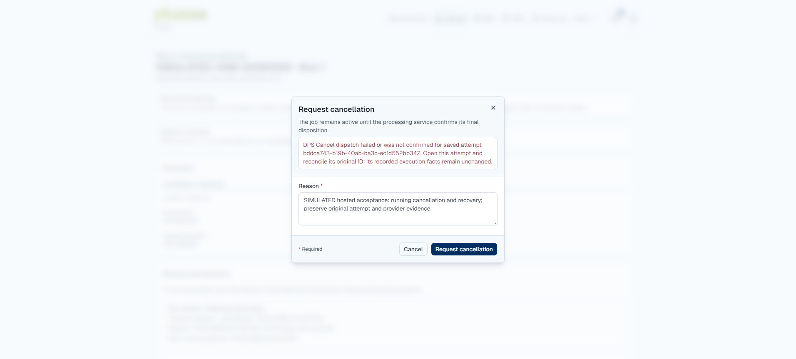

# Hosted assembly acceptance — October 20, 2026

**Result: failed. Full live acceptance is blocked by a reproducible DPS lifecycle
contract mismatch.** The hosted Linux software batch passed **51/51, zero
skipped**. Successful transport and provider processing do not establish
successful Portal completion, cancellation or lifecycle recovery.

The Owner requested hosted acceptance with the recipe kept Simulated, then
explicitly approved synthetic organization, order, sample, preparation-lineage
and FASTQ setup. No application code or validation was changed. No commit,
push, deployment, migration, external identity/access grant, notification
transmission or scientific release was performed.

## Target and retained fixture

| Item | Identity |
| --- | --- |
| Hosted API / Portal | `https://api.phaenobiotech.com` / `https://portal.phaenobiotech.com` |
| API source | `859f36055ac4ef668b3023065ecfbd3d8ee0067a` |
| API image | `sha256:175513e5c741915200efdd1904ba6c7c5144489cb35e88c2de86259004815a6d` |
| Connection / recipe | Verified mutual TLS **18883**; `pseq_data_assembler` **0.1.0**, **Simulated** throughout |
| Synthetic organization | `SIMULATED ASSEMBLY ACCEPTANCE 20261020`; `9612f591-9977-455c-a9e0-dce7e171a778` |
| Order / Lab Job | `05fab77e-af42-480b-a7a3-b170889a4e98` / `46b38b3a-0c54-463e-b048-eb37b9787c75` |
| Sample | `SIMULATED-ASM-20261020`; `231806cd-8168-4fcb-80fc-80c3bd060dff` |
| FASTQ set | `c3917787-96a3-4d0c-99ad-ba6eaa2c6eca`; 100 paired synthetic reads, 150 bases each |
| Assembly attempt | `bddca743-b19b-40ab-ba3c-ec1d552bb342` |
| Provider execution | `dps-bddca743-b19b-40ab-ba3c-ec1d552bb342` |

Setup used domain methods and clearly synthetic labels. It represents software
setup only; no physical receipt, preparation, NGS run or scientific QC is
claimed. The setup tool did not start an HTTP server or background workers.
Both retained 34,200-byte FASTQ files passed the real hosted ClamAV scanner and
existing S3 checks. Start and cancellation used the existing signed-in operator
and normal Portal controls. Exact input SHA-256 values:

- R1: `85facebdd80a5a1313d53fd229632fc9081ac8222dd949eb10cc9b70fc638ca2`.
- R2: `dcc5479bb70daaeb5d3c4232d30b70fd83d57beb1e0c2fae3dcfbae54acc7088`.

## Live acceptance results

Times below are October 21 UTC, which was October 20 Pacific.

| Case | Observed result |
| --- | --- |
| Start persistence/delivery | Request/outbox committed before dispatch; one Run command and one delivery attempt; provider Accepted at 03:41:29 |
| Progress | Portal showed 7%; independent Query later showed 27.69%, 83%, then 100% |
| Provider execution | Started 03:41:29; stopped 03:44:00; Succeeded at 03:44:01 |
| Portal completion | **Failed**: database remains Accepted with no fabricated execution times or disposition; attention required |
| Active-run protection | Second Start disabled in Portal; exactly one saved attempt and one Start retained |
| Running cancellation | Reason and Cancel command saved at 03:43:42; **zero Cancel delivery attempts**; dispatch blocked by invalid authoritative Query |
| Cancellation result | **Failed/unconfirmed** in Portal; provider completed the original run |
| Diagnostic downloads | Exact-version S3 output bytes verified independently; normal Portal download flow **blocked** |
| Scientific separation | Hosted analysis-link service rejected Simulated attempt; zero analysis, QC and result-package rows |
| Access | Real signed-in operator used for Start/cancellation; anonymous assembly route returned 401 |

DPS emits `percentage: 0` on **both Running and Succeeded lifecycle events**.
The unchanged [contract](../../contracts/poms-dps/v1/contract.schema.json)
requires `percentage: null` on lifecycle events. Numeric percentages belong on
Progress events or `latest_progress`. The invalid events also invalidate the
authoritative Query responses containing them. The worker reconciles Query
before dispatching cancellation, so Cancel cannot proceed either.

The actual C# contract validator rejected both captured events and Query
responses. Changing **only** `event.percentage` to `null` in offline copies made
each event and Query validate. No live message, saved fact or schema was changed.
See [Running validation](assets/2026-10-20-hosted-assembly/contract-running-validation.json)
and [Succeeded validation](assets/2026-10-20-hosted-assembly/contract-succeeded-validation.json).

## Recovery and output verification

At 03:45:04–03:45:22, the owned tunnel was interrupted for 12 seconds and
restored in a `finally` block; the existing API container was then restarted.
There were zero unrelated active assembly jobs. The same API image returned
healthy with TLS 18883 restored. The original attempt/provider identity and
**one Start delivery** remained. Transport restoration and duplicate-Start
avoidance passed, but lifecycle reconciliation still failed. The provider had
completed before this interruption; recovery during active provider work remains
a required retest.

Independent authenticated S3 reads verified exact immutable versions, sizes and
SHA-256 values for the output manifest and two placeholder artifacts. This is
provider/storage evidence, not successful Portal download acceptance.

| Object | Bytes | SHA-256 |
| --- | ---: | --- |
| Output manifest | 2,996 | `3ec93ac2165aef68b9b5222f3eb344472dfa5b3dbb45c6bcf6d0528a5ad7f24d` |
| Placeholder FASTA | 56 | `91f8fa5fc104dceebc0268d7424761d09f18df165ad162f1f0b8eb21dd4b48cd` |
| Diagnostic provenance | 280 | `21b8f79bd92e97f1243df58dfa9a3e9f31b9b8a67461f6a842933a1c04854a8c` |

The hosted analysis-link service guard returned the expected Simulated rejection
without creating scientific records. That negative service check does not
substitute for an HTTP JWT/role matrix.

## Hosted Linux software regression

Tests used Microsoft's native Linux .NET SDK 10.0.401/.NET 10.0.12 and a separate
PostgreSQL 18.6 container. Only the current schema/migration history were copied
into that disposable database. Tests did not use the shared Portal database;
the temporary database/container/internal network were removed afterward.

- `LabAssemblyTests`: 11 cases.
- `LabAssemblyMessagingTests`: 6 cases.
- `DpsContractTests`: 16 cases.
- `DpsMqttTlsTests`: 9 cases.
- Nine PostgreSQL cases covering discovery, restart without duplicate Start or
  percentage history, notification revocation/expiry, commit-before-ACK and
  duplicate receipts across receiver restart, delivery deadlines, final/cancel
  races and late progress, foreign/conflicting receipts, malformed manifests,
  and current FASTQ receipt/version/dispatch/QC consistency.

**51 executed, 51 passed, 0 failed, 0 skipped.** These include simulated queued
cancellation and cancellation races. No separate live queued-cancellation
attempt was created while the first attempt remained unresolved. Retained
[TRX results](assets/2026-10-20-hosted-assembly/assembly.trx) provide the exact
case names. No unrelated full-suite run was performed.

## Preservation and required retest

A fresh database dump passed an isolated restore before setup. The encrypted
off-server copy was collected and its ciphertext SHA-256 verified:
`0015d5e8536792c6e5dd9f1ab7589ac38457418210f542974ea1d5684f620945`.
Protected hosted recovery root:
`/var/backups/phaeno-portal-deploy/assembly-acceptance-20261020`.

Final checks verified **all 610 pre-existing rows across the 250-table database
unchanged**, including all Website contacts/demo-request history. Additions
are the approved synthetic fixture, audit/lifecycle/forecast history and one
inactive synthetic reviewer without external identity or membership. No existing
S3 object was deleted or overwritten. Eleven task-window S3 versions are retained,
including two unreferenced synthetic raw files from setup transactions that
rolled back when the temporary tool lacked the scanner's separate private
network. All task object keys/versions are recorded in the protected inventory.

API/database/scanner are healthy; tunnel active; public API health 200;
anonymous assembly 401; TLS 18883 and Simulated retained. Temporary credential
settings, tool binaries and disposable test containers/network were cleaned up.
Deployment holds, stale-release quarantine and disabled backup timer were
retained. Populated-S3 disaster recovery and scientific production qualification
remain separate gates.

Correct the server lifecycle serializer to send `percentage: null` on
non-Progress events, including journal replay and authoritative Query responses.
Then reconcile **the original attempt first** using its retained provider
Succeeded evidence; do not infer success or start a replacement while unresolved.
Retest separate success, running/queued cancellation, tunnel/API loss during
active processing, exact HTTP request replay, normal Portal diagnostic downloads
and scientific/role restrictions. Keep Simulated enabled.

The [owning plan](../../plans/ASSEMBLY-HOSTED-ACCEPTANCE-20261020-PLAN.md) tracks
the failed/blocked cases. Detailed protected evidence and task-only source remain
under `.artifacts/assembly-acceptance-20261020/`. No full-acceptance pass is claimed.
