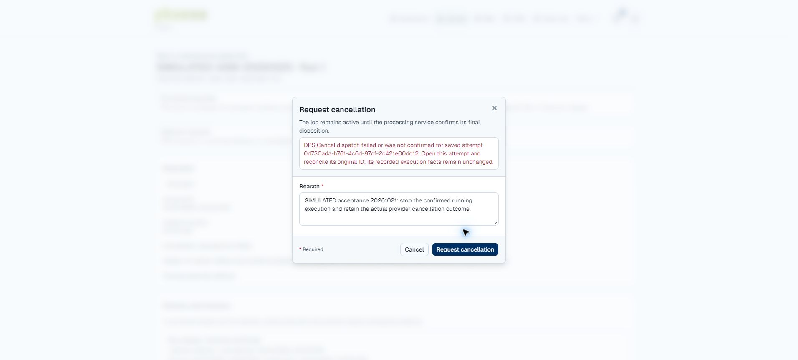

# Hosted assembly acceptance retry — October 21, 2026

**Result: partial progress; full acceptance still fails.** The lifecycle
percentage issue is corrected. Original completion and Portal downloads pass.
A new running-cancellation case terminates correctly, but its receipt is
rejected because second-resolution provider time appears 197.347 ms before
the full-precision request. The unresolved attention state blocks subsequent
assembly attempts and the remaining live recovery cases.

The Owner requested "Try again." This resumes the approved hosted synthetic
acceptance scope, reusing the existing fixture. No new organization, sample,
preparation lineage, scientific result, identity or access grant was created.
No application code, runtime validation, configuration, deployment, migration,
commit or push was changed. The signed-in operator completed browser sign-in.

## Verified correction and original completion

- Target: `api.phaenobiotech.com` and `portal.phaenobiotech.com`.
- API source remains `859f36055ac4ef668b3023065ecfbd3d8ee0067a` and image remains
  `sha256:175513e5c741915200efdd1904ba6c7c5144489cb35e88c2de86259004815a6d`.
- Verified TLS 1.3 on **18883**, with certificate hostname `localhost` and the
  existing CA/client identity. No certificate or authentication bypass.
- Capabilities confirm `pseq_data_assembler` **0.1.0**, authoritative Query,
  idempotent Start and cancellation. The configured recipe remains **Simulated**.
- Original attempt `bddca743-b19b-40ab-ba3c-ec1d552bb342` is now **Succeeded**,
  with original start `2026-10-21T03:41:29Z`, stop `03:44:00Z` and disposition
  `03:44:01Z`. It retains exactly one Start delivery.
- Its Query/event now have `percentage: null`; the unchanged C# validator accepts
  the actual Query, event and capabilities without modifying captured messages.
  The Portal reconciled completion at `20:31:07Z` before this retry's checks.

Both diagnostic files downloaded through the normal authenticated Portal and
retained their `SIMULATED-` filenames. Independent byte checks passed:

| Download | Bytes | SHA-256 |
| --- | ---: | --- |
| `SIMULATED-assembly-output.fasta` | 56 | `91f8fa5fc104dceebc0268d7424761d09f18df165ad162f1f0b8eb21dd4b48cd` |
| `SIMULATED-provenance-report.json` | 280 | `21b8f79bd92e97f1243df58dfa9a3e9f31b9b8a67461f6a842933a1c04854a8c` |

The browser download-event observer timed out for the Blob-triggered FASTA
download; the actual file was present and its size/hash verified. The download
was not retried or counted as failed because of that observer limitation.

## New running-cancellation case

The normal Portal Repeat action created attempt
`0d730ada-b761-4c6d-97cf-2c421e00dd12`, explicitly referencing the original
completed attempt and a Simulated cancellation-test reason. No Start was sent
until the original attempt had reconciled. Timeline below is October 21 UTC:

| Fact | Evidence |
| --- | --- |
| Requested | `21:30:51.464786Z` |
| Provider actually started | `21:30:52Z`; Portal saved Running and actual start |
| Visible progress | Portal showed 10%; provider's final retained progress was 13.22% |
| Cancel request committed | `21:31:27.197347Z` |
| Cancel delivery attempt | One, starting `21:31:27.270528Z` |
| Provider receipt | Accepted; exact matching command/job/provider IDs; `occurred_at_utc=21:31:27Z` |
| Provider terminal outcome | Terminated, actual stop and disposition `21:31:27Z` |
| Portal terminal outcome | Terminated with actual start/stop and 35-second duration retained |
| Delivery confirmation | Terminal event resolves outcome, but Cancel receipt remains unrecorded and attention persists |

The new Query, Terminated event and capabilities all pass the unchanged strict
schema validator. The remaining rejection occurs in
`DpsEventReceiver.ReceiveCommandAsync` at the comparison
`evidence.OccurredAtUtc < command.RequestedAtUtc`.

For Cancel command `c939d7ce-5899-4f23-9db2-2794db42d60b`, the stored request is
`2026-10-21T21:31:27.197347Z`; DPS receipt
`2872f20b-fe7c-40f8-abb9-8bd8b1e7afb5` reports
`2026-10-21T21:31:27Z`. The reported receipt thus precedes the request by
**197.347 ms**. The schema allows second-resolution timestamps; this is a
separate precision/ordering issue beyond the resolved schema mismatch.
Timestamp truncation is consistent with the observed whole-second values;
the exact server implementation and cross-server clock offset were not inspected.

The Portal showed "DPS Cancel dispatch failed or was not confirmed" even though
the actual terminal event persisted. It retains the original data and an
attention warning. No timestamp, receipt or state was rewritten to force a pass.
The latest attention state correctly prevents another repeat attempt. Active
tunnel/API interruption, queued cancellation and full request replay therefore
remain blocked; no service interruption was attempted in this retry.

## Preservation and next gate

A fresh full database recovery copy passed isolated restore before new work.
The off-server encrypted copy has SHA-256
`ff13e818878dba2ae43e67c9bf08ac074678a63190dbe8cb5240200fe0c0d328`.
Hosted recovery root:
`/var/backups/phaeno-portal-deploy/assembly-acceptance-20261020/retry-20261021`.

All **610 original non-fixture rows remain unchanged**, including Website intake
history. The retry baseline had 756 rows: its only pre-existing row changed by
this run is the explicitly reused synthetic Lab Job's normal version/update
stamp. Additions are one test assembly, its two commands, receipts, events and
audit history. There are zero active processing attempts, zero scientific
analyses and zero scientific output packages. Original completed history remains
intact. API, database, scanner and tunnel are healthy, with TLS 18883 and
Simulated retained; public health is 200 and anonymous assembly is 401.

The October 20 **51/51** hosted Linux software batch remains prior evidence; it
was not rerun or counted as new execution. This retry added live Portal and
provider checks plus validation of newly captured actual messages. No code
change was made to the Portal or DPS.

Resolve the receipt timestamp precision/ordering rule consistently for command
receipts and lifecycle comparisons, preserving original reported timestamps,
matching command identities and meaningful rejection of genuinely older evidence.
Reconcile this exact Terminated attempt first; then resume the blocked cases.
Do not start another attempt or manually clear attention to bypass the issue.

Evidence:
[completion validation](assets/2026-10-21-hosted-assembly/completion-contract-validation.json),
[cancellation schema validation](assets/2026-10-21-hosted-assembly/cancellation-contract-validation.json),
[exact cancellation timing](assets/2026-10-21-hosted-assembly/cancellation-timing.json),
[Portal download verification](assets/2026-10-21-hosted-assembly/portal-download-verification.json).
Protected full evidence and task-only helpers are retained under
`.artifacts/assembly-acceptance-20261021/`. The
[owning plan](../../plans/ASSEMBLY-HOSTED-ACCEPTANCE-20261020-PLAN.md) retains the
original run history and current retry status.
