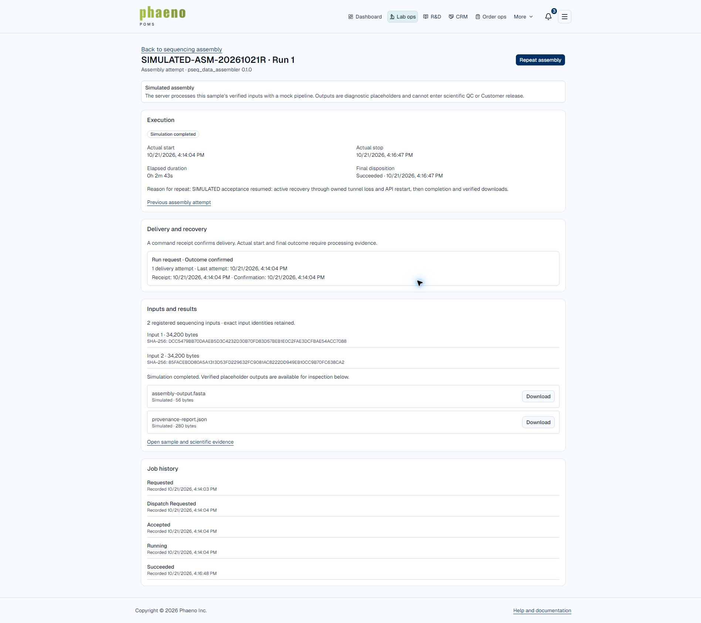
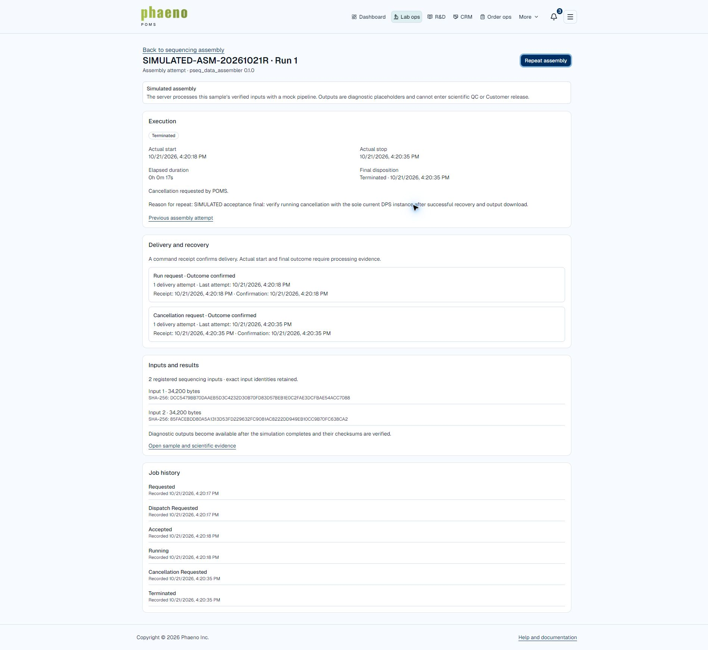
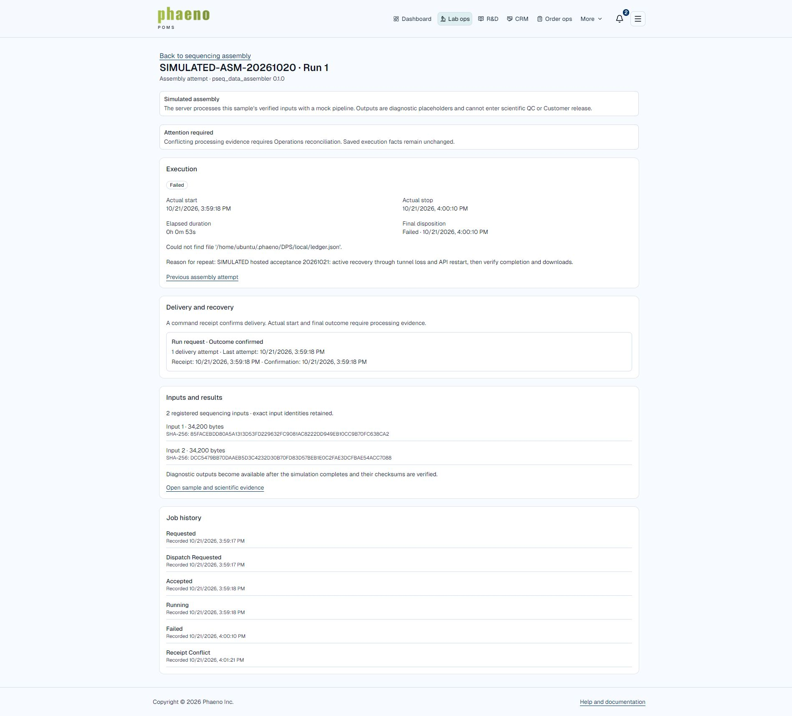

# Hosted assembly timestamp release and final acceptance — October 21, 2026

The timestamp correction is committed, pushed and active as API source
`79b0338f5f96b3a5fcbea24b86db89906e922f84`. The original whole-second Cancel
receipt now reconciles without changing execution times or delivering another
command. Fresh running cancellation, cancellation before dispatch, active
connection/API recovery, completion and authenticated output downloads pass with
the recipe **Simulated** and mutual TLS **18883**.

This closes the requested cancellation/recovery and completion journeys with the
qualifications below. It is not an unqualified full-protocol or scientific
acceptance: literal HTTP Start payload replay was not exercised, and a separate
earlier DPS ledger failure/conflicting outcome remains preserved for Operations.
The successful recovery window also includes an externally initiated DPS process
replacement, so it does not isolate the effects of only the two Portal-owned
interruptions. No DPS code or configuration was changed by this release.

## Acceptance ledger

| Case | Actual evidence | Result |
| --- | --- | --- |
| Transport and recipe | Released API confirms TLS discovery on 18883; strict private CA, hostname and client identity retained; `pseq_data_assembler` 0.1.0 Simulated | Pass |
| Original blocked cancellation | Attempt `0d730ada-b761-4c6d-97cf-2c421e00dd12` admits the original `21:31:27Z` Cancel receipt against request `21:31:27.197347Z`; attention clears at `22:54:23.456704Z`; original start/stop and one Run/Cancel delivery remain | Pass |
| Fresh running cancellation | Normal signed-in Repeat and cancellation produce Terminated, real execution times and one Run/Cancel delivery for `b6e1291d-1a40-4aff-aa14-fc9622a45849` | Pass |
| Cancellation before dispatch | Real hosted Start service with dispatcher lease held; normal signed-in Portal cancellation produces CancelledBeforeStart, no provider ID/start/stop and zero Start deliveries for `60e1e783-ac75-4dd6-bd5a-c0d4c146aa8a` | Pass at Portal queue boundary; no live DPS pre-start cancellation event claimed |
| Request identity and active guard | Exact Start service replay returns the same attempt; changed content under that identity and another active request each reject with 409 | Pass at service boundary; literal HTTP payload replay not run |
| Active connection recovery | During `d5e17b8d-45e9-4016-853e-1515832a6668`, owned tunnel stopped for 12 seconds, then restored; same execution/start, one Run delivery, Running recovered | Pass in combined interruption window |
| Active API recovery | Same API image restarted; healthy and TLS restored, same execution/start and one Run delivery retained | Pass in combined interruption window; DPS process also changed externally |
| Completion and persistence | That same attempt reaches Succeeded with immutable manifest and no attention; no fabricated times | Pass |
| Portal downloads | Both signed-in download controls return SIMULATED filenames; actual local byte counts and SHA-256 match the saved version-pinned manifest | Pass |
| Final running cancellation | Normal Repeat/cancel on `986dbb01-2ca7-4e8d-82a1-3bb4f8d58ee1` reaches Terminated with one Run and one Cancel, no attention | Pass |
| Scientific separation | Both fixture work orders have zero analysis runs, assembly QC and result output packages; placeholder warnings visible | Pass for persisted state and existing service guard; HTTP analysis-link denial not rerun |
| Preservation and recovery | All 610 original non-fixture rows and 115 unrelated files unchanged; all services healthy, zero active assemblies, 29 migrations unchanged | Pass |

The pre-release software batch remains **54/54 passing, zero failed/skipped**;
it was not rerun against the shared database. See the
[regression receipt](2026-10-21-dps-timestamp-regression.md). No frontend source
changed or frontend suite was run for this API-only release.

## Completed recovery and output identity

All times in this section are UTC on October 21, 2026.

- Attempt: `d5e17b8d-45e9-4016-853e-1515832a6668`.
- Provider execution: `dps-d5e17b8d-45e9-4016-853e-1515832a6668`.
- Requested: `23:14:03.110924Z`; actual start: `23:14:04.592632Z`.
- Owned tunnel outage begins `23:14:09.957110Z`, lasts 12 seconds.
- Same-image API restart: `23:14:22.356514817Z`; healthy/TLS recovery verified
  by `23:14:27.858551Z`.
- Actual stop: `23:16:47.814883Z`; disposition: `23:16:47.987604Z`.
- Exactly one Run delivery, no Cancel, attention null, Succeeded.

Read-only DPS snapshots showed only current PID 16624 before this run. The final
snapshot showed only PID 20071, with server-local process start
`Wed Oct 21 23:14:14 2026`. Codex did not start, stop or replace this process.
The timestamp lies within the recovery window; attribution of each individual
interruption is therefore qualified. The same saved job still recovered and
completed without another Start. The browser displayed stale progress after
restart; a reload showed the authoritative completed state. Automatic visual
refresh across that restart is not claimed as separately passed.

| Download | Bytes | SHA-256 |
| --- | ---: | --- |
| `SIMULATED-assembly-output (1).fasta` | 56 | `a313748484a17c710a4e6e35c00fd0c8a302396dbacbfab629e0a553a49c2dd3` |
| `SIMULATED-provenance-report (1).json` | 280 | `2b6bcf249608b2aed2def503e93d923770541dba472aea1da11c4e905c7cc3dd` |

The browser's `(1)` suffix preserves the operator's previous downloads. No old
Downloads files were removed or overwritten. The two new downloads were saved
at `23:19:48.6701784Z` and `23:19:54.6733482Z`, respectively.
See [download comparison](assets/2026-10-21-hosted-assembly-final/portal-download-verification.json)
and [active recovery evidence](assets/2026-10-21-hosted-assembly-final/active-recovery-resumed.json).

## Queued and running cancellation

The second fixture's queued case uses the actual configured DPS provider and
input verification/freeze through the hosted Start service. A temporary helper
holds the existing dispatcher advisory lease `(20260922, 1)` to create a
controlled pre-dispatch boundary. It does not invent a provider, write job state
directly or fabricate receipt/outcome evidence. The real Portal operator then
requests cancellation through the signed-in UI.

Attempt `60e1e783-ac75-4dd6-bd5a-c0d4c146aa8a` is requested at
`23:12:08.887627Z` and cancelled at `23:12:54.512432Z`. Its Run command is
suppressed with zero delivery attempts; no Cancel command is necessary.
Actual start, stop and provider execution stay null. Exact service-request
replay is idempotent; changed-request and concurrent-active-request guards pass.
The helper exits and releases its lease. A preliminary helper invocation could
not acquire the busy lease and created no attempt; a bounded retry succeeded.
See [boundary result](assets/2026-10-21-hosted-assembly-final/queued-result.json).

Final normal UI cancellation attempt `986dbb01-2ca7-4e8d-82a1-3bb4f8d58ee1`:
requested `23:20:15.921781Z`, actual start `23:20:18.393595Z`, cancellation
requested `23:20:35.094164Z`, actual stop/disposition `23:20:35.229315Z`.
Run and Cancel each have one delivery, both confirmed; no output or attention.

## Retained DPS failure and developer follow-up

First active recovery attempt `41e26472-16b3-41d2-9130-c041216a3da4` retained
its execution and one Start through tunnel/API interruption, but DPS then
reported two incompatible Failed outcomes:

| Event | Actual start / stop | Failure |
| --- | --- | --- |
| `e5919511-4b34-4f74-8383-30e4bb89066b`, sequence 151 | `22:59:18.1237404Z` / `23:00:10.7918733Z` | Missing `/home/ubuntu/.phaeno/DPS/local/ledger.json` |
| `2ed2884f-2243-4928-90d0-4c17c5e028f8`, sequence 305 | `22:59:18Z` / `23:01:21Z` | Missing `/home/ubuntu/.phaeno/DPS/local/ledger.json.tmp` |

These are different event IDs with conflicting terminal facts, not one event ID
with two hashes. Portal correctly preserves the first Failed execution facts and
records attention on the later conflict. No receipt, hash, timestamp, outcome or
safety guard was manually removed, rewritten or cleared. The old specimen
remains blocked for Operations reconciliation; this release adds no resolution
endpoint or data repair.

Read-only inspection at `23:04:21.675323Z` found two DPS processes sharing the
working directory: stale PID 11234 used a replaced/deleted executable, while
PID 16624 used the current executable. The Owner authorized stopping only the
stale PID and retrying. It had already exited when the guarded stop precheck
ran, so **Codex sent no signal**. Subsequent snapshots showed one current
process. Shared ledger writes are a plausible explanation, not a confirmed
source-level diagnosis. The server developer should investigate single-instance
ownership, atomic ledger replacement and consistent replay of terminal facts.

## Isolated resumption and preservation

The retained conflict prevents safe reuse of the first specimen. After a fresh
verified database recovery, the existing authorization for isolated synthetic
records was used for `SIMULATED ASSEMBLY ACCEPTANCE 20261021R`:

- Organization `563c434d-db06-4b46-9989-aa704bf78145`.
- Order `7302ac03-1442-4e54-a330-bf889722ce1b`.
- Laboratory work order `7722f311-e4ec-4d29-a533-29d5e97800f5`.
- Specimen `618c1df2-4255-43a3-a81a-7ba8a2173f99`,
  `SIMULATED-ASM-20261021R`.

Domain-based setup retains synthetic preparation/send-out/FASTQ lineage and two
34,200-byte, 100-read inputs. No external identities, permission changes,
customer notifications, wet-laboratory/scientific claims or release operations.

At `23:21:02.127803Z`, all **610 original non-fixture rows** remain byte-content
equivalent to their original fingerprints. Relative to the fresh pre-release
baseline, only one existing assembly-command row, one assembly-job row and one
work-order row changed through normal reconciliation/acceptance. Authorized new
synthetic rows and normal audit/receipt rows are retained. All **115 unrelated
runtime/document files** retain their hashes and permissions; runtime settings
are unchanged. Website history remains fully preserved: 12 contacts and six Demo
requests, including completed/unsubscribed history. All 29 migrations remain;
there are zero active assemblies and zero analyses/QC/output packages across
both fixtures. See [postflight](assets/2026-10-21-hosted-assembly-final/final-postflight.json).

API, database and scanner are healthy, tunnel active, API loopback port 18883
available. Public health/Portal/Website return 200; unauthenticated assembly
returns 401. The existing manual deployment hold, orphan-run quarantine, both
Vercel Git holds and populated-S3 recovery deferral remain. Temporary local and
hosted helper builds/packages and private helper environment files were removed;
helper containers are absent. Evidence, encrypted recovery, permanent credentials,
the active release and synthetic history remain. The actual backup timer
`phaeno-portal-backup.timer` remains disabled/inactive. See
[cleanup receipt](assets/2026-10-21-hosted-assembly-final/cleanup.json).

Protected raw receipts and setup manifests are retained under
`/var/tmp/phaeno-assembly-acceptance-20261020/timestamp-release-20261021` and
ignored `.artifacts/dps-timestamp-release-20261021/collected` off-server. Final
evidence archive SHA-256 is
`b84698f2c6099464424dfc26c0d30378104b0cd29175985baada59df536d804a`.
The [release receipt](../../operations/dps-timestamp-test-release-20261021.md)
records image identity, restoring backups and publication boundaries.

## Remaining qualification boundaries

Literal authenticated HTTP Start payload replay and the HTTP scientific-link
denial were not run; the real hosted service identity/active guards and persisted
scientific separation passed. A live DPS pre-start cancellation event was not
forced; before-dispatch Portal cancellation passed. Independent interruption
attribution and automatic browser refresh remain qualified as described above.
The older provider conflict remains unresolved. None of these results qualify
populated-S3 disaster recovery, a real scientific recipe, physical workflows or
Customer release, and no such activation occurred.
